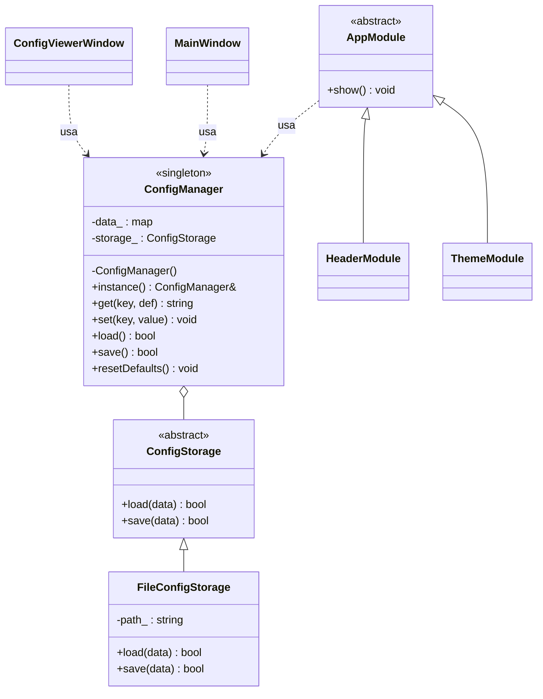

# Diagrama de clases



## Lectura del diagrama
- **ConfigManager** es el único Singleton. Tiene constructor privado y se obtiene con `instance()`.
- **ConfigStorage** es una interfaz: `ConfigManager` no sabe si guarda en archivo, base de datos, etc.
- **FileConfigStorage** hereda de `ConfigStorage` y guarda en `config.ini`.
- **AppModule** (consola) y las ventanas Qt (`MainWindow`, `ConfigViewerWindow`) consumen la misma instancia.
```